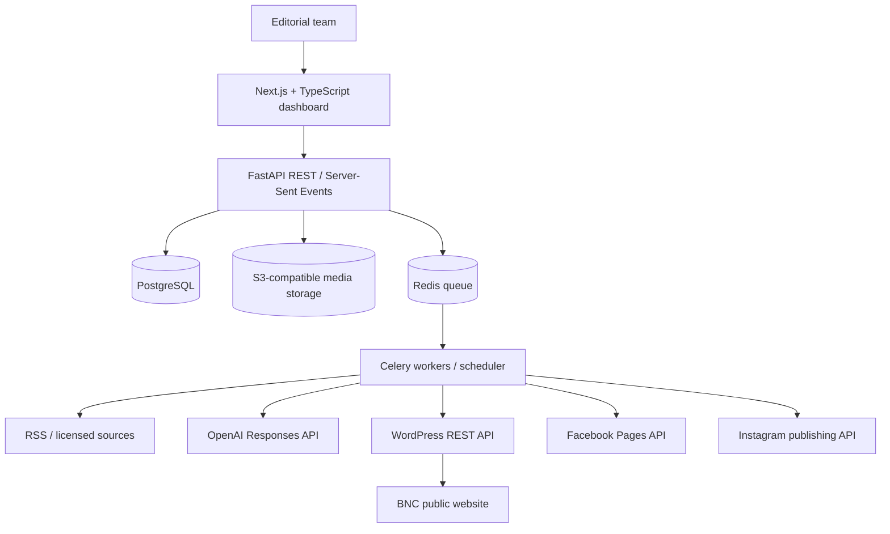

# BNC News Dashboard — Complete Architecture & Implementation Specification

**Brand:** BNC — Bangladesh News Corporation  
**Date:** 18 October 2026  
**Status:** Working newsroom and discovery/editorial intelligence; platform delivery and audience integrations remain planned. See implemented updates below.
**Brand assets:** Use the uploaded white-on-red BNC logo with shapla, doyel and river elements. Preserve its proportions; derive compact variants only from the original asset.

## 1. Executive summary

Build an independent newsroom dashboard to discover, review, write, approve and distribute news. **BNC PostgreSQL is the editorial source of truth**; WordPress is the public website publishing destination, and each social account is a separate destination. Initially surface approximately **20–50 ranked candidate stories per editorial cycle**, not automatically publish 50 articles. AI assists with drafting, classification, translation and captions but does not independently verify or approve news.

Launch with RSS feeds, manual stories, full-screen article editing, media upload, category/tag/author association, WordPress and Facebook publishing, publication logs and human approvals. Add Instagram templates and publishing, analytics and videos incrementally.

### Design principles

- Modular monolith before microservices; separate API, workers and public WordPress deployment.
- Human approval of the exact story revision published.
- Preserve source provenance, rights and audit trail.
- All platform publications are independently tracked and retried.
- Bengali-first, English-capable, desktop-first responsive interface.
- No scraping around paywalls or access restrictions; RSS doesn't itself grant full reproduction rights.

## 2. System architecture



| Layer | Preferred implementation |
|---|---|
| Dashboard | Next.js, React, TypeScript, Tailwind, shadcn/ui |
| Editor | TipTap / ProseMirror full-page rich text editor |
| Core API | Python FastAPI, Pydantic, SQLAlchemy, Alembic |
| Database | PostgreSQL, UUID keys, migrations |
| Background work | Celery with Redis broker; periodic scheduler |
| Media | S3-compatible object store; derivative generation |
| AI | OpenAI Responses API with Structured Outputs |
| Website | WordPress + optional custom BNC companion plugin |
| Publishing | Independent platform adapters and job tracking |
| Delivery | Docker Compose locally, isolated staging and managed production |
| Observability | Structured logging, error reporting, metrics and trace IDs |

## 3. Dashboard information architecture

Primary navigation:

1. **Overview:** pending reviews, ingestion/publishing status, delivery errors, editorial KPIs.
2. **News Feeds / Incoming Stories:** RSS monitoring, ranking, filtering, duplicates and story selection.
3. **Manual Writing / Story Editor:** full-page editor, not a narrow side modal; image upload, author, categories, tags, sources.
4. **Publishing:** channel-specific previews, approvals, schedules, publication state, retries.
5. **Published:** published records, platform permalinks, updates, corrections, retractions.
6. **Media Library:** licensed images, videos, metadata, attribution and alt text.
7. **Sources:** publishers, feeds, permitted usage, status and polling intervals.
8. **Analytics:** website and social platform measurements with capture timestamps.
9. **Connections & Settings:** integration accounts, role permissions, secrets references, audit logs.

**Preserve legacy HTML demo behavior:** independent RSS, manual writing and publishing tabs; a nearly full-screen story editing modal/view; story images; category/tag/user/author association; ability to work with incoming batches of 20–50 candidates; explicit publication queue and integration settings.

### Story editor requirements

- Types: full article, short news bite, breaking update, later live coverage.
- Languages: Bengali and English; bidirectional translation subject to approval.
- Fields: headline, summary, rich text, category, tags, author, source links, image and rights details, caption, SEO title/description, slug, publication times.
- Draft autosave, immutable version history, revision comparison and conflict warnings.
- Side-by-side source review available via collapsible panel, leaving writing space wide.
- Website, Facebook and Instagram previews.
- Approved revision ID is bound to publishing authorization; material edits revoke approval for the new version.

## 4. Roles, workflows and state machines

| Role | Permissions |
|---|---|
| SUPERADMIN | Full newsroom access; accounts/roles/status, assignments, sources, configuration and audit; explicit audited self-approval exceptions |
| EDITOR | Write/generate, review others' submitted revisions, approve/request changes/reject, schedule and authorize approved revisions for READY; no account/system administration |
| CONTENT_WRITER | Write/generate own or explicitly assigned drafts, media/credits/bylines, assigned tasks, submit and revise; no approval, scheduling or delivery authorization |

**Authoritative policy (19 October 2026):** these are the only three operational roles. The earlier Administrator, Editor-in-Chief, Journalist, Social Media Editor and Analyst/Viewer role proposal is historical and superseded. Individual server-side sessions replace the shared development editor token. Existing shared identities remain inactive Content Writers with historical foreign keys preserved, without automatically granting account access. See [Authentication and RBAC](api/authentication-and-rbac.md).

**Editorial states:** `DISCOVERED → SELECTED → DRAFT → IN_REVIEW → APPROVED → READY`; `IN_REVIEW → CHANGES_REQUESTED → DRAFT`; new edits after approval require reapproval. Manual stories begin at `DRAFT`. Post-publication states include `UPDATED`, `CORRECTED` and `RETRACTED` with immutable history.

**Per-destination publishing states:** `PENDING`, `SCHEDULED`, `RUNNING`, `CONFIRMED`, `RETRYABLE_FAILED`, `PERMANENT_FAILED`, `UNKNOWN_RECONCILE`, `CANCELLED`.

Always store reviewer, approved version, decision timestamp and reason. A breaking-news shortcut may reduce review latency but must still record authorized approval.

## 5. RSS and source ingestion

```text
Registered feed → scheduled fetch → parse RSS/Atom → normalize → deduplicate
→ cluster reports about same event → classify and rank → candidate queue
→ editor selection → BNC story draft
```

### Source registry

Store publisher, homepage, feed URL, categories, language, license/rights classification, permitted extraction mode, polling interval, last fetch, last error, ETag, Last-Modified, health and owner notes.

### Processing rules

- Prefer public RSS/Atom metadata and licensed APIs; avoid restricted extraction.
- Typical initial poll interval 5–15 minutes, adjustable with backoff, jitter and HTTP rate limiting.
- Use conditional GET via `If-None-Match` / `If-Modified-Since` when available.
- Normalize canonical URLs, source GUIDs, publication time and language. Persist timestamps in UTC and show Asia/Dhaka.
- Deduplicate by `(feed, guid)` where stable, normalized URL and content hashes.
- Cluster related reports; do not mistake multiple syndicated copies for independent corroboration.
- Detect/fail safely on malicious XML, HTML, large payloads and SSRF/private-network URLs.
- Do not blindly ingest or republish full articles or publisher photos without authorization.
- Keep provenance and reference links alongside every candidate.

### Initial candidate ranking

`score = .30*Bangladesh_relevance + .25*public_impact + .20*freshness + .15*corroboration + .10*uniqueness`

Inputs normalized 0–100. This is a configurable editorial heuristic, not an empirically proven algorithm. Allow editor pins and overrides. Surface approximately 20–50 candidates per editorial cycle; store all valid source records separately.

## 6. OpenAI newsroom integration

AI endpoints support story classification, tagging, headline suggestions, outline/draft generation, short news bites, Bengali/English translation, platform captions, claim extraction, revisions comparison and missing-evidence warnings.

**Pipeline:** selected source records → verified evidence packet with rights/attribution → prompt template and model choice → OpenAI Responses API → schema-validated JSON output → persist `ai_job` and draft revision → editor verification → approval. The AI does not publish directly.

Example structured response:

```json
{
  "language": "bn",
  "headline": "Illustrative Bengali headline",
  "summary": "Illustrative story summary",
  "paragraphs": [{"text": "Draft paragraph", "supporting_source_ids": ["source_123"]}],
  "category_slug": "business",
  "tags": ["bangladesh", "economy"],
  "claims_to_verify": ["Claim needing corroboration"],
  "editorial_warnings": [],
  "ready_for_review": false
}
```

Structured Outputs ensure a defined structure when supported; they do **not** guarantee that facts or quoted material are correct. Check source IDs actually exist and support claims. Never invent quotations, eyewitness accounts, identities, numbers or photos. Treat scraped material as untrusted prompt content and distinguish source content from governing instructions.

**Token/cost controls:** dedupe before AI; reuse unchanged item classifications; generate on demand or in carefully limited batches; smaller models for straightforward metadata operations; store model, prompt version, tokens, job status and estimated cost; set organization budgets and per-editor quotas. Keep API keys server-side, never in JavaScript bundles.

## 7. PostgreSQL database model

UUID primary keys and `created_at`/`updated_at` timestamps by default. Enforce foreign keys, permissions, unique constraints and migrations.

| Table | Representative fields |
|---|---|
| `users` | id, email, name, role, active, MFA_state |
| `sources` | id, publisher, homepage, language, rights, notes |
| `feeds` | id, source_id, url, polling_interval, etag, last_success |
| `ingested_items` | id, feed_id, guid, url, normalized_url, title, excerpt, published_at, hash |
| `story_clusters` | id, topic, last_activity |
| `cluster_items` | cluster_id, ingested_item_id |
| `stories` | id, type, language, status, author_id, current_version_id, approved_version_id |
| `story_versions` | id, story_id, version_number, editor_id, content_json, title, created_at |
| `story_sources` | story_id, ingested_item_id or source_id, evidence/rights notes |
| `categories`, `tags`, `story_tags` | normalized taxonomy and relations |
| `media_assets` | id, object_key, MIME, dimensions, alt_text, rights, creator, expiry |
| `story_media` | story_id, media_id, position and use |
| `approvals` | story_id, version_id, reviewer_id, outcome, timestamp |
| `ai_jobs` | story_id, model, template_version, input_hash, result, tokens, status |
| `channels` | id, type, remote_account_id, encrypted_secret_reference, capabilities |
| `channel_variants` | story_version_id, channel_id, caption, media IDs, format |
| `publications` | story_id, approved_version_id, channel_id, remote_id, permalink, status, scheduled_at |
| `publication_attempts` | publication_id, attempt, idempotency_key, result, error, timestamp |
| `scheduled_jobs` | job_type, target_id, run_at, status |
| `analytics_snapshots` | platform, remote_id, metrics_json, measured_at |
| `audit_events` | actor_id, action, resource_id, timestamp, event_details |

Indexes: source GUID/normalized URL, story status and update time, story revision uniqueness, publication channel and state, idempotency key, analytics platform/time. Store media in object storage, not PostgreSQL. Keep raw secrets outside the database or encrypt under managed key storage.

## 8. Backend API specification

FastAPI routes under `/api/v1`:

```http
GET    /api/v1/dashboard/overview
GET    /api/v1/sources
POST   /api/v1/sources
PATCH  /api/v1/sources/{id}
GET    /api/v1/feeds/items
POST   /api/v1/feeds/{id}/refresh
GET    /api/v1/story-clusters
GET    /api/v1/stories
POST   /api/v1/stories
GET    /api/v1/stories/{id}
PATCH  /api/v1/stories/{id}
GET    /api/v1/stories/{id}/versions
POST   /api/v1/stories/{id}/ai-draft
POST   /api/v1/stories/{id}/submit-review
POST   /api/v1/stories/{id}/approve
POST   /api/v1/media
GET    /api/v1/channels
POST   /api/v1/stories/{id}/publish
GET    /api/v1/publications
POST   /api/v1/publications/{id}/retry
POST   /api/v1/publications/{id}/cancel
GET    /api/v1/analytics/overview
GET    /api/v1/audit-events
GET    /api/v1/events/stream
```

- Enforce server-side authorization, consistent error schema, cursor pagination and limits.
- Save revisions with version preconditions (ETag/version) and return HTTP 409 for stale writes.
- Refresh, AI generation and publish routes return `202 Accepted` with `job_id`; UI observes SSE or polls status.
- Support idempotency keys for publication commands and reconcile external IDs after uncertain timeouts.

## 9. WordPress integration

WordPress renders public BNC articles and handles SEO, navigation, caching and the reader experience. The dashboard owns story decisions, provenance, versions and channel state. Use WordPress REST API over HTTPS with a dedicated integration identity and Application Password, held in a secrets manager. Permissions must be minimal.

### REST endpoints

```http
POST /wp-json/wp/v2/media
GET  /wp-json/wp/v2/categories
POST /wp-json/wp/v2/categories
GET  /wp-json/wp/v2/tags
POST /wp-json/wp/v2/tags
POST /wp-json/wp/v2/posts
POST /wp-json/wp/v2/posts/{id}
GET  /wp-json/wp/v2/posts/{id}
```

### Reliable publishing sequence

1. Verify an approved story revision and eligible media rights.
2. Map categories/tags/authors to WordPress IDs; create missing taxonomy only if permitted.
3. Upload featured image and retain WordPress media ID.
4. Convert rich text JSON to sanitized WordPress-compatible content.
5. Find existing remote post by stored ID/external mapping; otherwise create **WordPress draft**.
6. Store remote ID and update to `publish` only when the approved workflow requires it.
7. Read back status/permalink and confirm success.
8. Emit `website_published` event so dependent social posts can include the canonical URL.
9. If the request times out, reconcile before retry to prevent duplicate posts.

Add a small **BNC companion WordPress plugin** if needed for news-bite custom post type, corrections metadata, remote external-id mapping, and synchronization webhooks. Establish policy for direct WordPress editing (prefer dashboard-only changes or explicit two-way conflict handling).

## 10. Social media publishing

**One approved story → multiple independently approved channel variants and jobs.** Don't mark every destination published when one succeeds.

| Channel | Publishing output | Major requirements |
|---|---|---|
| WordPress | Full article or bite and permalink | Secure REST API credentials and role |
| Facebook Page | Link/image/caption | Meta app, eligible Page tokens and permissions |
| Instagram | Branded image/carousel/Reel with caption | Eligible professional account, API permissions, media container lifecycle |
| X | Short text and link | Verify current API plan/access |
| YouTube | Video/Shorts | YouTube Data API, OAuth and video rights |
| LinkedIn | Business/tech news | App permissions and organizational access |
| Telegram | Headline + article link | Bot/channel administration |

### Adapter interface

```python
class PublisherAdapter:
    def validate(self, variant): ...
    def prepare_media(self, variant): ...
    def publish(self, variant, idempotency_key): ...
    def poll_status(self, remote_ref): ...
    def reconcile(self, job): ...
    def get_permalink(self, remote_ref): ...
    def update_or_correct(self, job, directive): ...
```

Facebook can post to authorized Pages; this is not unrestricted personal-profile posting. Instagram requires media publication steps and typically an eligible professional account. Confirm up-to-date policies, API reviews, permissions, file constraints and posting limits before activation.

### Scheduler and retries

```text
Approved version → WordPress publish + confirm permalink
                ├─ Facebook variant job
                ├─ Instagram image/video job
                └─ other enabled channel jobs
```

Each job retains remote IDs, permalink, attempt history, scheduled time, status and errors. Retry transient 429/5xx with capped exponential backoff and `Retry-After`, use dead-letter queue for persistent failures. If remote outcome uncertain, mark `UNKNOWN_RECONCILE` and check platform before resending. Never retry successful channels merely because another failed. Corrections and retractions are separate operations for each destination.

## 11. BNC-branded social graphics and media

Use the actual uploaded BNC white-on-red logo (shapla/doyel/river mark). Define a restrained red, white and black brand palette; use legible Bengali/English typography and accessible contrast. Build deterministic square/portrait card templates via HTML/CSS server-side rendering, SVG or an image compositor. Support title safe zones, attribution, photography credits, alt text and template variants for breaking news.

**Do not generate fictitious editorial photographs** or treat a decorative AI visual as a documentary photo. Human preview of final image/crop is required before publishing.

## 12. Analytics and operations

Aggregate permitted metrics from GA4/WordPress and social channel APIs. Report story throughput, time-to-publish, sources and categories, traffic, referrals, reach, engagement, scheduling success and failure. Include measurement time, source and definitions; social metrics may be delayed or incomparable across platforms.

Operational dashboard: worker backlog, last successful RSS fetch, failures per feed, API credential expiry, publish queue and reconciliation alerts, AI usage/cost.

## 13. Security and legal controls

- TLS, secure HTTP-only session cookies, MFA for privileged users, RBAC on every backend action.
- API keys and tokens held in managed secrets; never stored in frontend JavaScript or exposed in logs.
- Malicious upload scanning, file type/size validation and safe media transformation.
- SSRF defense on feed URLs; XML hardening; HTML sanitization; protect AI against prompt injection in sources.
- Immutable approval and publishing audit trail.
- Separate development, staging and production credentials/accounts.
- Backups, object-store versioning, restore drills, request tracing and monitoring.
- Copyright and use-rights validation; don't assume RSS implies republication permission.
- Human verification for sensitive or contested allegations, politics, crime, health and public safety.
- Formal correction/retraction protocol; consider Bangladesh law and media obligations with local counsel.

## 14. Repo structure and deployment

```text
bnc-newsroom/
├── apps/dashboard/                 # Next.js app
│   ├── app/
│   ├── components/
│   ├── features/{feeds,stories,publishing,analytics}/
│   └── public/brand/               # supplied BNC logo
├── services/api/
│   ├── app/
│   │   ├── api/v1/
│   │   ├── auth/
│   │   ├── db/
│   │   ├── ingestion/
│   │   ├── editorial/
│   │   ├── ai/
│   │   ├── media/
│   │   ├── publishing/adapters/
│   │   ├── analytics/
│   │   └── workers/
│   ├── alembic/
│   └── tests/
├── integrations/wordpress-plugin/
├── infrastructure/docker-compose.yml
├── docs/{architecture,api,editorial-policy,runbooks}/
├── .env.example
└── README.md
```

**Local:** Docker Compose runs Next.js, FastAPI, Celery, Redis, PostgreSQL and S3-compatible storage. **Staging:** separate WordPress staging website and safe test credentials. **Production:** isolated API/worker deployment, managed databases, backups, alerts and a CDN/WAF-protected WordPress host. Store times in UTC and show Asia/Dhaka in the dashboard.

Example environment variable names (never commit real values): `DATABASE_URL`, `REDIS_URL`, `S3_BUCKET`, `OPENAI_API_KEY`, `OPENAI_MODEL`, `WORDPRESS_BASE_URL`, `WORDPRESS_USERNAME`, `WORDPRESS_APPLICATION_PASSWORD`, `META_APP_ID`, `META_APP_SECRET`, `APP_TIMEZONE`.

## 15. Testing and acceptance criteria

The current account/review implementation additionally requires separate authenticated Writer and Editor workflow tests, MFA/session revocation, last-Superadmin protection, task reassignment/access checks, field-level readiness UI checks and revision-bound approval invalidation. See [Editorial approval](api/editorial-approval.md) and [Task assignment](api/task-assignment.md). External platform delivery tests below remain future-phase acceptance criteria.

**Unit:** source parsing, dedupe, authorization, version conflicts, output schema validation, HTML safety, publication state machine.

**Integration:** valid/invalid RSS feeds, WordPress media/draft/update/publish in staging, Facebook API responses/permissions, ambiguous timeouts and independent retries, asset copyright flags.

**End-to-end:**

1. Register feed and ingest a candidate once; repeat ingest does not duplicate.
2. Convert candidate into manual/AI-assisted draft while retaining sources.
3. Edit article in full-page editor with image, category, tags and author.
4. Submit and approve specific revision.
5. Publish to WordPress staging and verify remote article URL.
6. Publish separately to authorized Facebook Page with status tracking.
7. Simulate Instagram failure and confirm WordPress/Facebook remain successful.
8. Materially revise article, verify new version requires reapproval.
9. Correct an article and track platform-by-platform correction status.
10. Restore database backup and recover publication and audit records.

## 16. Build roadmap

| Phase | Planning target | Deliverables | Acceptance gate |
|---|---|---|---|
| 1. Foundation | Weeks 1–2 | Branded UI, auth, DB/migrations, editor, media, approvals | Create/edit/review draft end-to-end |
| 2. RSS + AI | Weeks 3–4 | Source registry, ingestion, dedupe, queue, AI draft jobs | RSS candidate becomes traceable reviewed draft |
| 3. Publishing | Weeks 5–6 | WordPress connector, Facebook connector, jobs/retries, scheduling | Approved story publishes once with confirmed remote URL |
| 4. Hardening | Weeks 7–8+ | Analytics, audit, tests, rights controls, backups, production deployment | Security and restore acceptance passed |

Eight weeks is an **aspirational MVP planning window**, not a guarantee; social platform approval/review and content licensing can extend it.

## 17. Approximate early operating budget

| Item | Illustrative USD/month |
|---|---:|
| Dashboard/API/workers | $30–80 |
| Database and Redis | $20–60 |
| WordPress hosting | $20–60 |
| Object storage, CDN, backups | $5–20 |
| OpenAI API | $10–60 |
| Monitoring/miscellaneous | $5–20 |
| **Total** | **$90–300** |

Planning estimates, not verified quotes. Exclude labor, paid source rights, paid platform API tiers, images, and high-traffic/video processing.

## 18. Implementation decisions

- **BNC is the product identity**; use the supplied logo and full name Bangladesh News Corporation.
- **PostgreSQL/BNC is the editorial master**; WordPress is a publication destination.
- **Modular FastAPI monolith** with Next.js frontend and Celery workers.
- **RSS first**, permitted APIs/extraction later; avoid unauthorized copying.
- **Humans approve AI-assisted news**; no autonomous claims verification.
- **First integrations** WordPress and authorized Facebook Page; Instagram after media template/API access readiness.
- **Full-page editor** with images, category/tag/author association and revision tracking.
- **Every channel independent** with retries, reconciliation, remote IDs and corrections.

## 19. Immediate implementation task

Start with repository setup, PostgreSQL models/migrations, Docker Compose, API authentication and the BNC-branded Next.js dashboard. Adapt the current `Newsroom_Dashboard.html` UX; retain RSS, Manual Writing and Publishing workflows. Deliver the first vertical slice:

`RSS item → candidate queue → draft → edit → approve → WordPress staging publish → recorded remote URL/status`.

Then add Facebook posting and Instagram publishing adapters.

## 20. Official reference documentation

- WordPress REST API: https://developer.wordpress.org/rest-api/
- WordPress post endpoints: https://developer.wordpress.org/rest-api/reference/posts/
- WordPress media endpoints: https://developer.wordpress.org/rest-api/reference/media/
- WordPress authentication: https://developer.wordpress.org/rest-api/using-the-rest-api/authentication/
- OpenAI Responses API: https://developers.openai.com/api/reference/resources/responses/
- OpenAI Structured Outputs: https://developers.openai.com/api/docs/guides/structured-outputs
- Meta Graph API: https://developers.facebook.com/docs/graph-api/
- Instagram Platform API: https://developers.facebook.com/docs/instagram-platform/
- YouTube Data API: https://developers.google.com/youtube/v3

**Maintenance note:** API permissions, product access and costs change. Verify live provider requirements against official docs during implementation. This document is the architectural baseline, not proof that integrations have been connected.

## Source attribution: automatic credits, editorial flags and manual entry

**Editorial rule:** BNC should automatically carry original-source attribution into AI-assisted articles, news bites and social variants wherever possible. **Missing source credit is a non-blocking dashboard warning, never an automatic publishing prohibition.** Editors remain responsible for source review and publication decisions.

- Preserve structured source records: publisher name, original URL, source type, publication/retrieval time, rights notes and supporting claims. Do not fabricate credits or links.
- Prepopulate publisher names and original links from ingested source metadata when known; retain credits through summaries, translations, updates and platform variants.
- Provide a clearly visible, editable **Sources & Credits** section in the full-page story editor. Editors can **Add Source**, edit or delete an attribution entry, type a manual publisher name, optionally supply an original URL, add a credit note, and designate original BNC reporting.
- Show a prominent **Missing source credit** or **Attribution needs review** warning on the story/editor/publishing screens when appropriate. Allow the editor to publish despite the warning; never automatically disable the Publish button solely because attribution is absent.
- At publication, display an unobtrusive warning/confirmation when source fields are incomplete. Record who proceeded and when in the audit trail; do not require a forced justification.
- Website articles should render the supplied source credit(s) and clickable URLs when available. Channel adapters should preserve appropriate visible credits in Facebook posts and Instagram captions/cards; adapt link placement to platform capabilities.
- For manually entered credits without URLs, render the publisher or attribution text without inventing a destination.
- On updates or corrections, preserve or allow revision of the credit list and its audit history.
- **Rights remain independent:** attribution alone does not authorize copying restricted text or photographs; enforce applicable permissions separately from the missing-credit warning.

**Suggested data fields:** `story_sources.publisher_name`, `story_sources.original_url` (nullable), `story_sources.attribution_text`, `story_sources.is_original_reporting`, `story_sources.rights_status`, `story_sources.entry_method` (auto/manual), `story_sources.last_edited_by`; `channel_variants.attribution_rendered`; `publications.attribution_warning_at_publish`.

**Acceptance test:** Generate an AI draft from an RSS item with no recovered source credit. Verify a warning appears and a manual source-entry form is available; publishing remains enabled for an otherwise approved story. Add a publisher credit manually and verify it appears on WordPress and appropriate social outputs. Publish another approved story with the warning unresolved and verify the choice is logged, without being blocked for missing attribution.


## Sources and Incoming Stories — HTML demo parity requirements (October 2026)

**UI reference:** `html demo/Newsroom_Dashboard(2).html`, specifically the Sources and Incoming Stories views. Preserve the newer Next.js/FastAPI/PostgreSQL/Celery source ingestion, attribution, AI drafting, ranking, audit trail and security protections. The original HTML provides the desired editorial layout and interaction model—not the production data layer. Never reintroduce fictional collection, browser-localStorage as canonical storage, simulated publication, or demo-only success messages.

### Sources: centralized Automatic Story Collection settings

Restore the demo's prominent **Automatic Story Collection** panel at the top of the Sources page. It should expose these controls with explicit, documented semantics:

| Control | Desired behavior |
| --- | --- |
| Stories per batch | Configure the candidate display limit, 20–50. This is **not** a cap on ingestion/storage and must not fabricate extra candidates. |
| Default collection interval | Global default for **newly added** sources; source-specific intervals remain editable and take precedence. Do not overwrite existing custom intervals. |
| Draft language | Global default for new draft creation and AI-generation language; editors can override per story. It must not translate or alter incoming feed contents automatically. |
| Collection source mode | Supported feeds (RSS/Atom/JSON Feed), permitted website feed discovery, public supported feed APIs and manual references. Surface capabilities honestly; unsupported website extraction/API adapters must be labeled as not available rather than silently enabled. |
| Preferred categories | Configurable editorial defaults/filter preferences; preserve feed-derived categories and per-source category overrides. Do not mistake filtering for a collector rights override. |
| Automatic collection | Enable/disable the scheduler at a clear global policy level while respecting per-source activation, permissions, limits and backoff. Changing this must require a real backend setting; do not present a nonfunctional toggle. |

Put editable **per-source overrides** and the live Sources registry below the global panel. Existing source features must stay available: Add Source, Test Source with results, source edit, activate/deactivate, per-source interval, collection health, last success/error, next run, Collect Now and links to discovered feeds. Support a safe **Archive Source** action (with confirmation and reversible restoration where appropriate); preserve stored candidates, original URLs, publisher/source provenance, audit history and existing article credits. Avoid destructive hard deletion of cited source records.

Where a global setting has not yet been implemented in the backend, show it as unavailable/planned until persistence, API contract and tests exist. The `Sources` page is the primary home for collection configuration. News Feeds may show the active batch limit and link to Sources instead of owning a separate competing setting.

### Incoming Stories / News Feeds: restore editorial table workflow

Keep the production route and backend candidate APIs, but redesign the **News Feeds** page using the HTML demo's **Incoming Stories** table layout and straightforward navigation:

- Add the four newsroom summary counters: **Incoming**, **Original Drafts**, **Awaiting Publication**, **Published**. Populate these from real database-backed counts. Never show fabricated totals. Where later publishing/approval infrastructure does not yet exist, display the honest unavailable or zero state with a clear definition.
- Retain the original table's main columns **Story**, **Category & Tags**, **Users**, **Status**, **Actions**. Augment Story with the publisher, original publication date, feed and source link. Include category and tags visibly; do not imply candidate records have AI-generated tags before a saved draft does. Authors/assignees may be unassigned.
- Restore horizontal feed/source-filter pills for convenient switching, and keep the current publisher dropdown or searchable selector for large registries.
- Preserve current production filters: editorial status, category and headline search; preserve pagination/cursors, ranking score, pin/unpin, select, dismiss/restore, evidence/provenance details, and rights notes.
- Provide a one-click **Edit Story** action. If no draft exists, create it through the existing **idempotent** candidate-to-draft API and open the shared immersive editor; otherwise open its existing saved draft. Never silently replace or duplicate a story. Handle loading, errors and stale data.
- Add a clear **Refresh Queue** action to fetch actual backend candidates. **Do not** reintroduce the demo's `Collect sample batch` as if it fetched real sources. Direct users to Sources → Collect Now when they want a real collection job; optionally provide an explicitly labeled development-only sample tool isolated from production.
- Opening AI-derived or candidate-derived drafts must expose editable, persisted **headline, summary, body, category, tags, language, source credits and social caption suggestions**. On applying an AI preview, auto-populate suggested category and tags in the standard story editor; edits survive save/reopen.
- Maintain source attribution automatically when available and show non-blocking missing-credit warnings. Allow manual publisher name, original URL (optional) and credit note editing. Missing credit alone must **not** block a separately authorized publication; rights and editorial approvals remain independent.

### UX and engineering acceptance criteria

1. A publisher added in Sources is tested, activated and collected using real API/worker execution. A scheduler run respects global defaults and any per-source override.
2. New candidates appear in Incoming Stories with publisher/date, category, applicable tags, status, and evidence links; filters and source pills select the correct records. The four counters reflect real backend state.
3. Clicking **Edit Story** for a new candidate creates exactly one draft and opens the shared full-page editor; reopening the same candidate opens the same draft.
4. AI-generated category and tags populate the metadata area, remain editable and persist through PostgreSQL revision saves and reloads.
5. Deactivating/archiving a source prevents new collection according to policy without erasing source attribution or previously collected stories.
6. Missing source attribution is flagged, can be manually amended, and does not automatically disable publishing solely because of that warning.
7. Run lint, typecheck, frontend build, backend unit/integration tests (including database-backed tests), and verify no regressions in existing ingestion security and AI functionality. Document any unimplemented global setting explicitly.

**Development priority:** match the original demo's editorial usability while preserving the production application's real behavior; never substitute UI-only controls for backend functionality.

## 21. Implemented account, assignment and review extension

The authoritative three-role policy in section 4 is enforced by FastAPI for every protected newsroom endpoint. The Next.js proxy forwards HttpOnly session cookies rather than a shared token; navigation hides unauthorized administration. Passwords use Argon2id, MFA secrets use encrypted TOTP enrollment, and all account status/role/security changes revoke sessions. Superadmins must enroll MFA before accessing the newsroom. Bootstrap is an interactive one-time trusted-host command without default credentials.

Additive migration `e41b02a77d31` extends users and existing publication requests, adds login sessions, password-reset tokens, persistent authentication throttles, newsroom tasks and immutable review decisions, and retains existing stories, AI jobs, provenance, images, request records and audit events. Legacy publication preparation does not become implicitly approved.

The operational flow is Login → Assigned Task → Draft → Readiness Validation → IN_REVIEW → APPROVED → READY. Rejection returns the story for changes while recording REJECTED on the request; withdrawal returns DRAFT with history. Self-approval is denied for Editors and requires an explicit reasoned Superadmin exception. Edits invalidate approval; platform authorization always remains bound to the submitted immutable revision. READY never means PUBLISHED. External WordPress/Facebook/Instagram delivery is explicitly excluded from this phase.

See the account, task and editorial API guides for route contracts, security settings, current list limits, deployment prerequisites and implementation limitations.
## Implemented news intelligence extension — 21 October 2026

The modular monolith now extends the existing collector and ranking path with app/intelligence: provider adapters, controlled classification, persistent cost reservations, conservative event clusters and four-window trend snapshots. Seven additive tables plus provider metadata fields preserve original candidates, story IDs, assignments and immutable revisions. Collection → eligible metadata classification → cluster → trend → existing candidate score → recommendation → existing draft/editor is the implemented path. No publication or approval is automated.

Celery runs a leased intelligence cycle on a configurable cadence. Cheap deterministic classification precedes optional bounded OpenAI calls; PostgreSQL serializes budget reservations across workers. Recommendations use the existing relevance/impact/freshness/originality concepts with configurable trend/evidence weights. Missing Google Trends/audience data is unavailable, and publisher counts are never independent-confirmation claims. Editorial classification overrides and manual cluster merges/splits are audited and persist across cycles.

Next.js adds Trending Stories, Recommended for Publishing and Superadmin AI Intelligence Settings. The existing Sources form supports provider configurations/manual Instagram leads; task creation and draft opening reuse current APIs and RBAC. Existing localhost/ngrok exact-origin security is preserved. See [News intelligence](api/news-intelligence.md) for the API, deployment configuration, permissions, operational bounds and verified integration limits. The original architecture sections above include future platform delivery features; this extension does not implement them.
