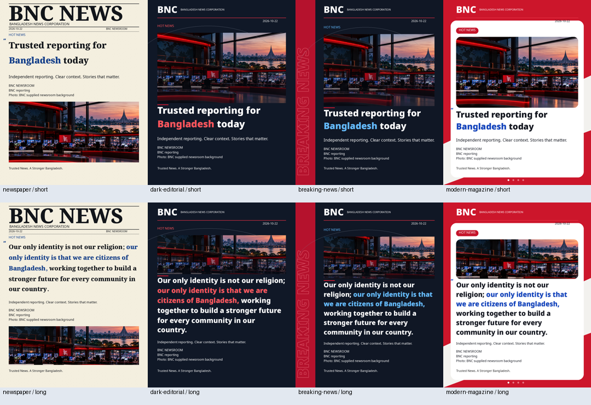
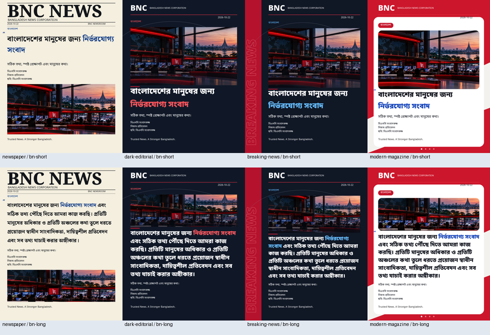

# News Bite visual evidence

The original four reference designs were inspected and compared with these adaptive
recreations. Typography, decoration and photo placement differ from the taller references;
these are not pixel-perfect reproductions. Reference screenshots are not used as backgrounds.
The photograph is the previously supplied BNC newsroom background. All examples are
verification artwork, not published news or evidence of external platform delivery.

Every **export** below is a real **1080 × 1350 PNG**. Browser screenshots show the responsive
preview at its displayed size. PNG byte equality was checked both for browser download
versus preview and for API preview versus immutable saved graphic.

| Template | Short export | Long export | Bengali short / long | Browser short / long |
| --- | --- | --- | --- | --- |
| Newspaper | [PNG](newspaper-short.png) | [PNG](newspaper-long.png) | [Short](newspaper-bn-short.png) / [Long](newspaper-bn-long.png) | [Short](screenshots/newsbite-newspaper-short.png) / [Long](screenshots/newsbite-newspaper-long.png) |
| Dark Editorial | [PNG](dark-editorial-short.png) | [PNG](dark-editorial-long.png) | [Short](dark-editorial-bn-short.png) / [Long](dark-editorial-bn-long.png) | [Short](screenshots/newsbite-dark-editorial-short.png) / [Long](screenshots/newsbite-dark-editorial-long.png) |
| Breaking News | [PNG](breaking-news-short.png) | [PNG](breaking-news-long.png) | [Short](breaking-news-bn-short.png) / [Long](breaking-news-bn-long.png) | [Short](screenshots/newsbite-breaking-news-short.png) / [Long](screenshots/newsbite-breaking-news-long.png) |
| Modern Magazine | [PNG](modern-magazine-short.png) | [PNG](modern-magazine-long.png) | [Short](modern-magazine-bn-short.png) / [Long](modern-magazine-bn-long.png) | [Short](screenshots/newsbite-modern-magazine-short.png) / [Long](screenshots/newsbite-modern-magazine-long.png) |

The renderer tests additionally exercise 5/15/30/50-word headlines in both languages,
overflowing text, landscape/portrait/square/low-resolution photos, and subjects near an
edge. Impossible layouts show an explicit warning and cannot export or become READY.
